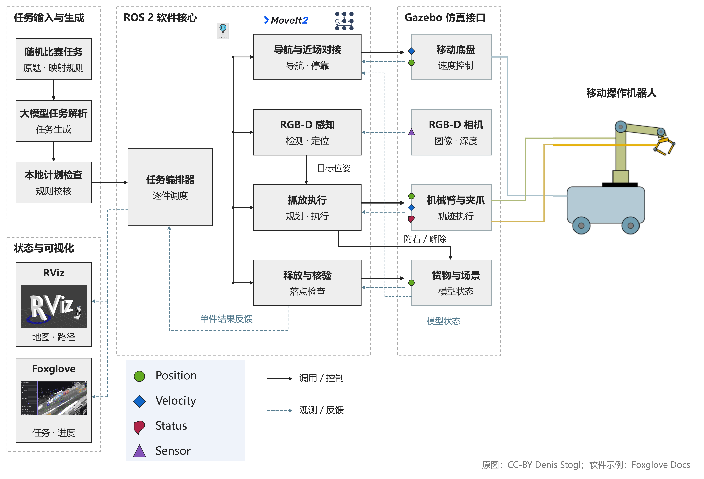

# 基于大模型任务解析的移动机器人自主搬运系统

我们是「东风小车，使命必达」。这次在第八届 AIC 大模型技术创新赛湖北赛区获得省赛三等奖，很遗憾未能晋级国赛。我们公开省赛项目的源码、系统设计和测试记录，供技术交流和复现参考。仓库内保留的赛方资源来自本届备赛，后续比赛请以当届官方发布为准。第三方资产按各自许可使用。 [湖北赛区公示](https://www.aicomp.cn/notice/notice-4/5708.html)

给定随机题目、抓取顺序和颜色区域映射，系统在 Gazebo 中逐件完成识别、抓取、运输和放置，并用实际落点核验结果。每件货物处理结束后，系统更新区域占用并选择下一件。

- [省赛交付成果](#省赛交付成果)
- [比赛要求对照](#比赛要求对照)
- [完整案例与批量结果](#完整案例与批量结果)
- [系统架构](#系统架构)
- [快速开始](#快速开始)
- [源码索引](#源码索引)

## 省赛交付成果

以下时间均为北京时间，依据本地归档及媒体元数据。

- **演示视频**于 2026 年 10 月 22 日 **12:19:50** 生成，成片长 **3 分 49.58 秒**，时间来自 MP4 内嵌元数据。
- **算法源码**于 2026 年 10 月 23 日 **19:29** 打包，归档源提交为 `8e5f73d`。打包记录覆盖源码、对应路径矩阵及出题程序，并保留校验信息。
- **技术文档**的本地最后修改时间为 2026 年 10 月 23 日 **20:28:52**，覆盖项目概述、功能设计、系统集成、测试验证与总结。

平台提交时间以报名系统回执为准。下文案例的 **158.790 秒** 为单轮执行阶段用时。

## 比赛要求对照

分值来自赛题规则的评审打分表。各项列出团队的实现与验证证据。逐项官方得分暂无可核记录。 [赛题官方页面](https://www.aicomp.cn/tracks/4559.html)

### 1. 系统启动 · 10 分

**要求**　机器人与场景完整加载并显示在仿真环境中。

**实现与进度**　统一启动器加载 `world2`、机器人、导航、感知与机械臂组件，并报告 `SYSTEM READY`。省赛归档保留 Gazebo 场景与运行画面。公开版本还需要在干净的目标 Linux 环境复跑。


### 2. 题目解析与面板显示 · 10 分

**要求**　解析、发布本轮题目指令，并在面板显示。

**实现与证据**　大模型将题目、抓取顺序和变量映射转换为结构化计划。本地检查字段、颜色、区域和顺序约束，接纳后锁定本轮计划。归档中的宠物店题涉及容量取整、条件颜色映射和变量区域映射，形成「先把两件蓝色货物搬到 B 区，再把三件红色货物搬到 A 区」的有序计划。面板展示任务与执行状态。

### 3. 按顺序抓取 · 20 分

**要求**　按照题目指定顺序成功抓取货物。

**实现与证据**　Nav2 把机器人送到取货附近，近场对接负责朝向和速度。RGB-D 模块根据轮廓及稳定深度估计目标点，经 TF 转换后，交由机械臂执行预抓取、夹持和抬升。归档案例中五件货物均一次尝试完成。


### 4. 搬运至指定区域 · 20 分

**要求**　按题目顺序把货物放到指定区域。

**实现与证据**　调度结合候选货物、路径估时和可用槽位逐件决策。释放后检查实际落点和区域占用。归档案例两蓝到 B 区、三红到 A 区，五件均通过严格区域内核验。


### 5. 动态避障 · 10 分

**要求**　在移动物体影响作业路线的场景中完成避障。

**实现与结果**　场景设置两个往复移动障碍，导航根据环境观测更新局部运动。主统计组在该场景中完成 **28/32** 个有效任务轮，第一处障碍的名义峰值速度为 **0.400 m/s**，第二处为 **0.094 m/s**。碰撞与接触情况缺少逐轮统计。


*图中展示导航状态。整轮完成结果来自测试记录。*

### 6. 状态反馈 · 10 分

**要求**　从面板查看路径、工作进度、机械臂抓取状态与每轮任务完成情况。

**实现与证据**　Foxglove 汇集比赛任务、导航和执行状态。操作人员在任务面板查看计划与进度，并结合诊断视图和 Gazebo 观察抓取、释放和核验阶段。


### 7. 场景复杂度 · 10 分

**要求**　构建会增加机器人作业难度的场景。

**实现与证据**　团队在 `world2` 中布置货物、放置区与隔墙，并设置两处往复移动障碍。同色多货物带来选择问题，隔墙与放置区入口约束进出路线，区域内多槽位还需要考虑占用和退离空间。场景全貌和槽位布局见上图。

### 8. 技术文档 · 20 分

**要求**　通过技术文档说明算法设计、创新性与完成逻辑。

**交付情况**　省赛技术文档已归档。五章分别说明任务目标、功能设计与关键技术、系统集成、测试验证以及总结与展望。README 展示其中的架构、部署方法和主要验证证据。

## 完整案例与批量结果

同一轮执行的实际顺序为 **蓝 3 → B1、蓝 4 → B2、红 4 → A1、红 1 → A2、红 3 → A3**。本轮尝试五件、完成五件，五件均通过严格区域内核验。单件尝试耗时 **25.637–38.648 秒**，整轮执行阶段耗时 **158.790 秒**。


省赛准备阶段的四批 Gazebo 测试保留了失败轮次。

- **全部尝试**　34 轮中完成 28 轮，完成率 **82.4%**。
- **有效任务轮**　排除两次运行环境异常后，32 轮中完成 28 轮，完成率 **87.5%**。
- **执行耗时**　32 个有效轮的执行阶段中位数为 **171.09 秒**，包含 4 个未完成轮。计时范围不含题目获取和计划生成。

## 系统架构



大模型与本地检查生成可执行计划。逐件调度用路径矩阵和分阶段估时选择货物、路线与槽位，并考虑当前选择对剩余任务的影响。Nav2、RGB-D 感知与机械臂按执行阶段交接。释放与落点核验结果回流给调度，并同步到 Foxglove。

## 快速开始

### 环境与资源

- **系统** Ubuntu 22.04、ROS 2 Humble。
- **运行组件** Gazebo、Nav2、MoveIt、OpenCV，以及各 ROS 包的 `package.xml` 声明的依赖。
- **场景** 使用 `world2`。地图、模型、点位和路径矩阵须按对应场景配置成套使用。
- **出题程序** 历史版 `TMSCQtest_x86_x64.bin` 位于工作区根目录。后续比赛请从当届官方渠道领取，具体版本和平台以当届通知为准。 [赛方资料入口](https://www.aicomp.cn/tracks/4559.html)
- **模型服务** 运行解析链路需要自行配置 DeepSeek。参考 [空白 API 配置模板](src/yzbot/aic_task/config/api_secrets.example.yaml)，在同目录创建本机 `api_secrets.yaml`，填入自己的密钥并保持该文件在 Git 之外。

### 构建与前置检查

配齐环境和场景资源后，从工作区根目录执行。

```bash
source /opt/ros/humble/setup.bash
export AIC_LOG_BASE="$PWD/logs/readme-check"
mkdir -p "$AIC_LOG_BASE"
cd src/yzbot

python3 start_competition.py --world world2 --setup
python3 start_competition.py --world world2 --dry-run
```

`--dry-run` 检查环境和资源。前置检查通过后，使用 `python3 start_competition.py --world world2` 正式启动。看到 `SYSTEM READY` 后核对题目、映射与结构化计划，再开始执行。本次文档更新只核对了入口与参数，完整运行仍以目标 Linux 环境下的实测为准。

## 源码索引

- [统一启动入口](src/yzbot/start_competition.py)
- [比赛启动与场景接线](src/yzbot/aic_bringup/)
- [题目解析与输入校验](src/yzbot/aic_task/aic_task/task_input/)
- [逐件调度与路径代价](src/yzbot/aic_task/aic_task/planning/)
- [执行编排与单件结果](src/yzbot/aic_task/aic_task/orchestration/)
- [视觉检测与抓取](src/yzbot/aic_perception/)
- [导航配置](src/yzbot/bot_navigation/)
- [路径矩阵](verification/)
- [核心源码许可证](src/yzbot/LICENSE) · [IFRA LinkAttacher 许可证](src/yzbot/IFRA_LinkAttacher/LICENSE.md)
