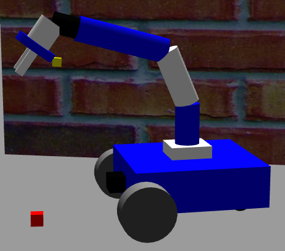
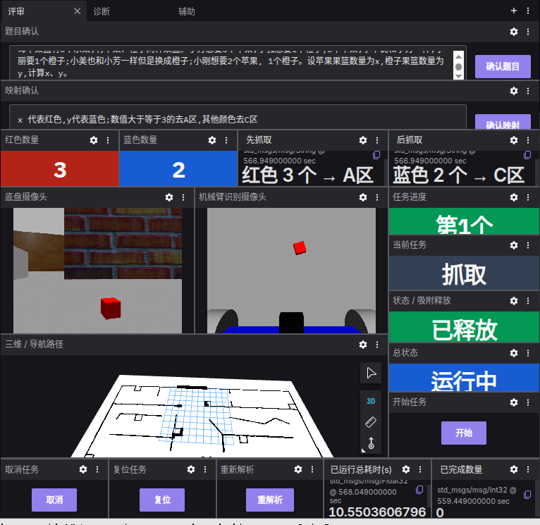

# 基于大模型任务解析的移动机器人自主搬运系统

> **参赛声明**
>
> 我们是「东风小车，使命必达」。湖北赛区公示给我们的结果是**省赛三等奖，未晋级国赛**。作为队长，我想直说，**这次没进国赛，我不服气。** 我们做出了从随机题目到五件货物搬运和落点核验的完整流程，也有失败记录。我把代码、实现细节和测试口径公开，供大家交流和复现。
>
> **请慎重选择赛道。** 报名前先看评分表、晋级方式和平台条件，算一算团队要投入的时间。如果主要目标是进国赛，尤其要先弄清这个赛题怎么打分、怎么晋级。 [湖北赛区官方公示](https://www.aicomp.cn/notice/notice-4/5708.html)
>
> **公开本项目仅为技术交流。** 随仓库保留的赛方出题程序、仿真资源等来自我们此前备赛和提交所用的版本。它们属于历史资料，后续比赛的赛题、规则、程序与环境请以当届组委会发布为准。第三方资产按各自许可使用。 [赛题官方页面](https://www.aicomp.cn/tracks/4559.html) · [湖北赛区通知](https://www.aicomp.cn/notice/notice-2/4630.html)

**2026 AIC 大模型技术创新赛 · Gazebo 仓储仿真 · ROS 2 Humble**

给定随机题目、抓取顺序和颜色区域映射，系统生成有序搬运计划，驱动机器人在 Gazebo 中逐件完成识别、抓取、运输、释放和落点核验。每一件货物的实际放置结果都会反馈给后续调度。


*Gazebo 场景总览。机器人在货物区与指定放置区之间执行有序搬运。*

- [系统架构](#系统架构)
- [快速开始](#快速开始)
- [测试结果](#测试结果)
- [源码索引](#源码索引)

## 系统架构


*任务生成、逐件调度、导航、视觉抓放与状态展示通过 ROS 2 连接。*

### 1. 把题目变成可执行计划

大模型读取原题、抓取顺序和颜色区域映射，输出结构化搬运计划。本地程序检查字段、颜色、区域与顺序约束，接受本轮计划后再交给执行模块。

### 2. 逐件比较货物、路线和槽位

同色货物有多个候选时，系统结合路径矩阵与分阶段估时比较取货与放置组合，并考虑对剩余任务的影响。每件释放后，根据落点和区域占用更新后续选择。


*预设槽位为候选落点。实际释放结果用于更新占用。*

### 3. 从导航交接到 RGB-D 抓取

Nav2 负责长段导航。靠近目标后，机器人经候选停车位和近场对接调整朝向与速度。视觉模块从颜色轮廓与稳定深度估计目标点，经 TF 转换后交给机械臂完成预抓取、夹持和抬升。




*三张图分别对应导航接近、目标检测与机械臂预抓取。*

### 4. 核验落点并推进下一件

货物释放后，执行端检查实际落点和区域占用，再推进单件计数。Foxglove 面板展示计划、当前动作、运行状态和完成进度。



## 快速开始

### 环境与资源

- **系统** Ubuntu 22.04、ROS 2 Humble。
- **运行组件** Gazebo、Nav2、MoveIt、OpenCV，以及各 ROS 包的 `package.xml` 声明的依赖。
- **场景** 使用 `world2`。地图、模型、点位和路径矩阵须按对应场景配置成套使用。
- **出题程序** 历史版 `TMSCQtest_x86_x64.bin` 位于工作区根目录。后续比赛请从当届官方渠道领取，具体版本和平台以当届通知为准。 [赛方资料入口](https://www.aicomp.cn/tracks/4559.html)
- **模型服务** 运行解析链路需要自行配置 DeepSeek。参考 [空白 API 配置模板](src/yzbot/aic_task/config/api_secrets.example.yaml)，在同目录创建本机 `api_secrets.yaml`，填入自己的密钥并保持该文件在 Git 之外。

### 构建与前置检查

配齐环境和场景资源后，从工作区根目录执行。

```bash
source /opt/ros/humble/setup.bash
export AIC_LOG_BASE="$PWD/logs/readme-check"
mkdir -p "$AIC_LOG_BASE"
cd src/yzbot

python3 start_competition.py --world world2 --setup
python3 start_competition.py --world world2 --dry-run
```

`--dry-run` 检查环境和资源。前置检查通过后，使用 `python3 start_competition.py --world world2` 正式启动。看到 `SYSTEM READY` 后核对题目、映射与结构化计划，再开始执行。本次文档更新只核对了入口与参数，完整运行仍以目标 Linux 环境下的实测为准。

## 测试结果

省赛准备阶段的一轮归档案例按序将**两件蓝色货物搬到 B 区、三件红色货物搬到 A 区**，五件均通过严格区域内核验。


- **全部尝试**共 34 轮，完成 28 轮，完成率 **82.4%**。
- **有效任务轮**排除两次运行环境异常后共 32 轮，完成 28 轮，完成率 **87.5%**。
- **执行阶段耗时中位数**为 **171.09 秒**，计时范围不含题目获取和计划生成。

结果来源为省赛技术文档汇总的四批 Gazebo 测试，属于团队测试记录。

## 源码索引

- [统一启动入口](src/yzbot/start_competition.py)
- [比赛启动与场景接线](src/yzbot/aic_bringup/)
- [题目解析与输入校验](src/yzbot/aic_task/aic_task/task_input/)
- [逐件调度与路径代价](src/yzbot/aic_task/aic_task/planning/)
- [执行编排与单件结果](src/yzbot/aic_task/aic_task/orchestration/)
- [视觉检测与抓取](src/yzbot/aic_perception/)
- [导航配置](src/yzbot/bot_navigation/)
- [路径矩阵](verification/)
- [核心源码许可证](src/yzbot/LICENSE) · [IFRA LinkAttacher 许可证](src/yzbot/IFRA_LinkAttacher/LICENSE.md)
