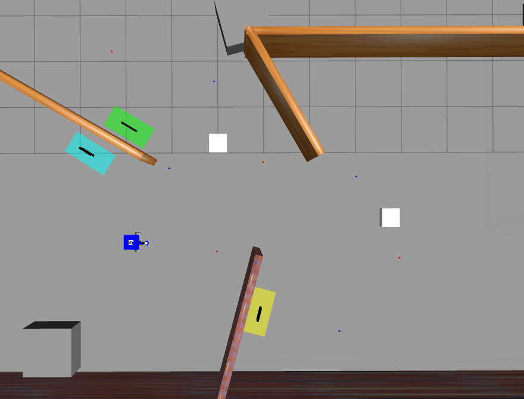
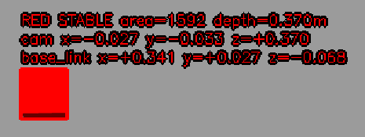
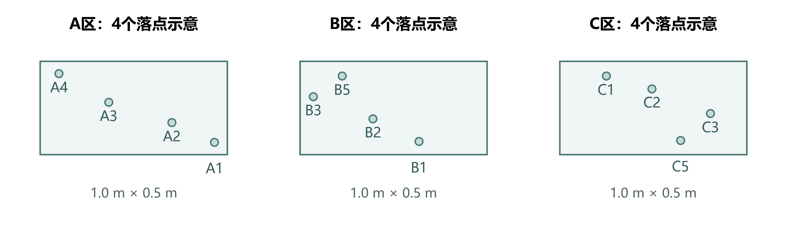
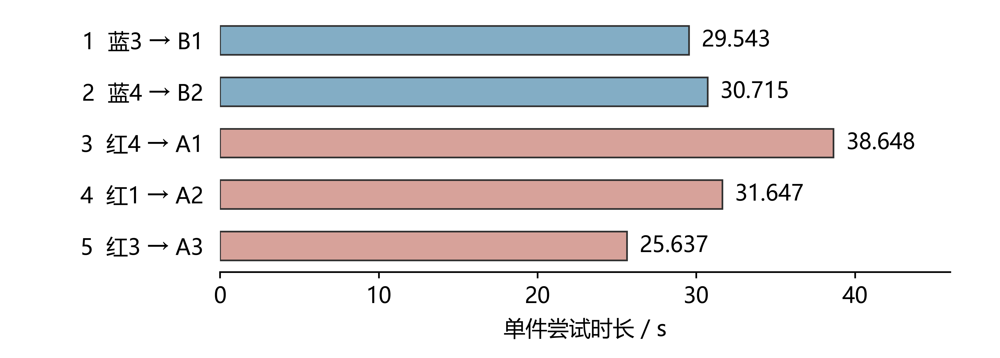
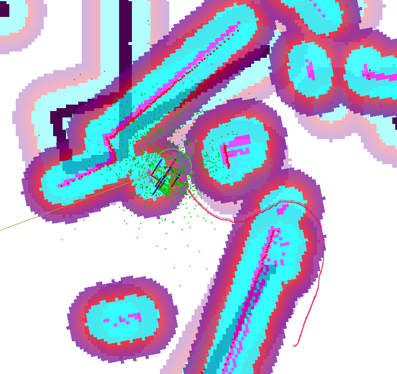

<h1 align="center">基于大模型任务解析的移动机器人自主搬运系统</h1>

<p align="center"><strong>从随机赛题解析到自主抓取、搬运与落点核验</strong></p>

<p align="center">
  <a href="https://docs.ros.org/en/humble/"></a>
  <a href="#完整案例"></a>
  <a href="src/yzbot/bot_navigation/"></a>
  <a href="src/yzbot/aic_perception/"></a>
  <a href="#比赛要求对照"></a>
</p>

<p align="center">
  <a href="#完整案例">完整案例</a> ·
  <a href="#比赛要求对照">比赛要求对照</a> ·
  <a href="#快速开始">快速开始</a> ·
  <a href="#参赛复盘">参赛复盘</a>
</p>

[](#完整案例)

**5/5 件**通过严格区域内核验（同一轮）　·　**158.790 秒**单轮执行阶段耗时　·　**28/32 轮**有效任务完成（四批测试）

> 我们公开省赛项目的源码、系统设计和测试记录，供技术交流和复现参考，严禁直接抄袭。 [公开范围与交付记录](#参赛复盘)

## 完整案例

### 从题目到有序计划

归档中的宠物店题经过容量取整、条件颜色映射和变量区域映射，形成两段指令。先把两件蓝色货物搬到 B 区，再把三件红色货物搬到 A 区。系统校验并接纳计划，Foxglove 显示本轮任务和执行进度。


### 从导航到抓取

Nav2 把机器人送到取货附近。近场对接调整朝向与速度，RGB-D 感知从颜色轮廓和稳定深度估计抓取点，经 TF 转换后交给机械臂完成预抓取、夹持和抬升。

<p>
  
  
</p>

*左图为 RGB-D 检测输出，右图为机械臂预抓取姿态。*

### 选择槽位并核验落点

调度结合候选货物、路线估时和可用槽位逐件作出选择。货物释放后，系统核验实际落点并更新区域占用。



归档中的实际执行顺序为 **蓝 3 → B1、蓝 4 → B2、红 4 → A1、红 1 → A2、红 3 → A3**。五件均一次尝试完成并通过严格区域内核验。单件尝试用时 **25.637–38.648 秒**，整轮执行阶段用时 **158.790 秒**。



## 比赛要求对照

括号内为官方评分项分值。下列证据来自团队的技术文档和测试归档，逐项官方得分暂无可核记录。 [赛题官方页面](https://www.aicomp.cn/tracks/4559.html)

1. **系统启动（10 分）**　要求完整加载机器人与仿真场景。统一启动器加载 `world2`、机器人、导航、感知和机械臂组件，并报告 `SYSTEM READY`。证据见首屏场景图，公开版本的干净 Linux 环境复跑待完成。
2. **题目解析与面板显示（10 分）**　要求解析、发布本轮指令并在面板显示。解析模块生成结构化计划，本地校验字段、颜色、区域和顺序。证据见[例题与 Foxglove 面板](#从题目到有序计划)。
3. **按顺序抓取（20 分）**　要求按本轮顺序抓取目标。导航、近场对接、RGB-D 与机械臂按阶段交接。证据见[抓取流程](#从导航到抓取)及归档案例的五件执行记录。
4. **搬运至指定区域（20 分）**　要求按顺序放置至指定区域。系统逐件选槽、释放并核验落点。证据见[区域布局与实测结果](#选择槽位并核验落点)，严格区域内核验为 **5/5**。
5. **动态避障（10 分）**　要求完成对移动物体的避障。场景设置两处往复移动障碍，主统计组名义峰值速度分别为 **0.400 m/s** 和 **0.094 m/s**，完成 **28/32** 个有效轮。逐轮接触和碰撞情况缺少统计。
6. **状态反馈（10 分）**　要求显示路径、任务进度、抓取状态和每轮完成情况。Foxglove 汇集路径和任务状态，结合诊断视图展示抓取、释放和核验阶段。证据见[任务面板](#从题目到有序计划)。
7. **场景复杂度（10 分）**　要求场景增加作业难度。`world2` 使用同色多货物、隔墙、多槽位放置区和往复移动障碍。证据见首屏场景和[放置区布局](#选择槽位并核验落点)。
8. **技术文档（20 分）**　要求说明算法设计、创新性与完成逻辑。省赛已归档五章技术文档，覆盖项目概述、功能设计、系统集成、测试验证及总结。交付时间见[参赛复盘](#参赛复盘)。



*RViz 展示局部路径。整轮完成结果来自相应测试记录。*

## 批量测试结果

省赛准备阶段的四批 Gazebo 测试保留了失败轮次。

- **全部尝试**　34 轮中完成 28 轮，完成率 **82.4%**。
- **有效任务轮**　排除两次运行环境异常后，32 轮中完成 28 轮，完成率 **87.5%**。
- **执行耗时**　32 个有效轮的执行阶段中位数为 **171.09 秒**，包含 4 个未完成轮。计时范围不含题目获取和计划生成。

## 系统架构


大模型与本地检查生成可执行计划。逐件调度用路径矩阵和分阶段估时选择货物、路线与槽位，并考虑当前选择对剩余任务的影响。Nav2、RGB-D 感知与机械臂按执行阶段交接。释放与落点核验结果回流给调度，并同步到 Foxglove。

## 快速开始

### 环境与资源

- **系统** Ubuntu 22.04、ROS 2 Humble。
- **运行组件** Gazebo、Nav2、MoveIt、OpenCV，以及各 ROS 包的 `package.xml` 声明的依赖。
- **场景** 使用 `world2`。地图、模型、点位和路径矩阵须按对应场景配置成套使用。
- **出题程序** 历史版 `TMSCQtest_x86_x64.bin` 位于工作区根目录。后续比赛请从当届官方渠道领取，具体版本和平台以当届通知为准。 [赛方资料入口](https://www.aicomp.cn/tracks/4559.html)
- **模型服务** 运行解析链路需要自行配置 DeepSeek。参考 [空白 API 配置模板](src/yzbot/aic_task/config/api_secrets.example.yaml)，在同目录创建本机 `api_secrets.yaml`，填入自己的密钥并保持该文件在 Git 之外。

### 构建与前置检查

配齐环境和场景资源后，从工作区根目录执行。

```bash
source /opt/ros/humble/setup.bash
export AIC_LOG_BASE="$PWD/logs/readme-check"
mkdir -p "$AIC_LOG_BASE"
cd src/yzbot

python3 start_competition.py --world world2 --setup
python3 start_competition.py --world world2 --dry-run
```

`--dry-run` 检查环境和资源。前置检查通过后，使用 `python3 start_competition.py --world world2` 正式启动。看到 `SYSTEM READY` 后核对题目、映射与结构化计划，再开始执行。本次文档更新只核对了入口与参数，完整运行仍以目标 Linux 环境下的实测为准。

## 源码索引

- **启动与场景**　[统一启动入口](src/yzbot/start_competition.py) · [场景和节点接线](src/yzbot/aic_bringup/)
- **题目与计划**　[题目读取、解析与输入校验](src/yzbot/aic_task/aic_task/task_input/)
- **调度与执行**　[货物、路线和槽位决策](src/yzbot/aic_task/aic_task/planning/) · [任务编排与单件结果](src/yzbot/aic_task/aic_task/orchestration/) · [路径矩阵](verification/)
- **导航与抓取**　[Nav2 配置](src/yzbot/bot_navigation/) · [视觉检测和抓取](src/yzbot/aic_perception/)
- **许可证**　[核心源码 Apache-2.0](src/yzbot/LICENSE) · [IFRA LinkAttacher 许可证](src/yzbot/IFRA_LinkAttacher/LICENSE.md)

## 参赛复盘

这次在第八届 AIC 大模型技术创新赛获得省赛三等奖，很遗憾未能晋级国赛。本次比赛耗时两个月，金额大概2500rmb（包含报名费，u盘费，token费用）
说实话不是非常懂此比赛的评审机制，也有诸多不服之处，不过结果如此也没有办法，比赛要求五分钟内完成并符合其他要求，本次我们的实现如下，从我的个人感官来看已经非常良好了，不过不知道赛题组的要求是什么。
时也命也，不过本次至少收获了我对ros2系统和机器人仿真系统的技术理解和实现，也算是一次不错的探索。

仓库内保留的赛方资源来自本届备赛，后续比赛请以当届官方发布为准。第三方资产按各自许可使用。 [湖北赛区公示](https://www.aicomp.cn/notice/notice-4/5708.html)

### 省赛交付记录

以下时间均为北京时间，依据本地归档及媒体元数据。

- **演示视频**于 2026 年 10 月 22 日 **12:19:50** 生成，成片长 **3 分 49.58 秒**，时间来自 MP4 内嵌元数据。
- **算法源码**于 2026 年 10 月 23 日 **19:29** 打包，归档源提交为 `8e5f73d`。打包记录覆盖源码、对应路径矩阵及出题程序，并保留校验信息。
- **技术文档**的本地最后修改时间为 2026 年 10 月 23 日 **20:28:52**，覆盖项目概述、功能设计、系统集成、测试验证与总结。

平台提交时间以报名系统回执为准。
